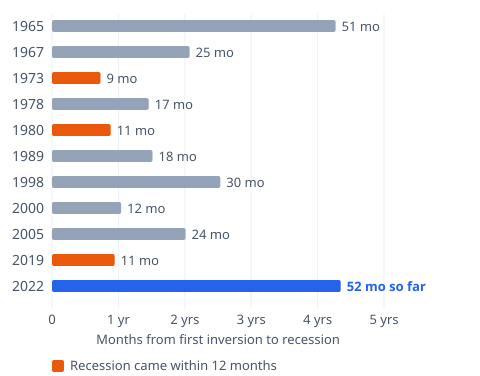
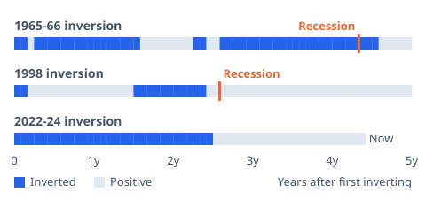
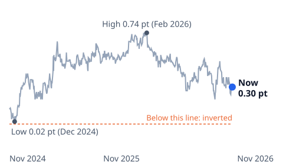
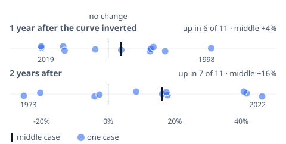

# [When Was the Last Yield Curve Inversion? What History Says](https://mkviz.com/yield-curve-inversion/)

## Research note

**Question.** When was the last yield curve inversion, how long after an inversion have recessions started, and what happened in the cases where the wait was long?

**Short answer.** The 10-year minus 2-year spread was inverted from April 2022 to early September 2024 (888 days days, the longest since 1976), and no recession has started in the 55 months since it began. On the longer 10-year minus 1-year spread (from 1962), the curve was inverted in the 12 months before each of eight recessions, but only three of 10 finished inversions had a recession within 12 months of first inverting (median wait about 18 months). The two long waits before 2022 (from late 1965, and 1998) ended only after the curve inverted a second time.

### Data
- 10-year and 1-year Treasury constant-maturity yields, daily since Jan. 2, 1962 (FRED: DGS10, DGS1), through Nov. 16, 2026.
- 10-year minus 2-year (T10Y2Y, from June 1976) and 10-year minus 3-month (T10Y3M, from 1982), through Nov. 17, 2026.
- NBER recession months (FRED: USREC).

### Method
- Inverted day: the 10-year at or below the 1-year (or 2-year). Inverted days less than six months apart join into one episode unless a recession started in between; days inside a recession don't count. (The 2026-11-07 version joined days within a year on the 2-year spread; six months on the 1-year spread keeps the 1965-66 and 1967-69 inversions apart.)
- Lead: months from an episode's first inverted day to the next recession start. Caught: for each recession start, whether the curve was inverted on any day from 12 months before to 3 months after.
- Second-inversion figure: for each case, months after the first inverted day marked inverted if any day that month was at or below zero, with the first recession month after the start.
- Recession probability: probit of a recession within 12 months on the monthly average 10-year minus 3-month spread, fitted on 1982-2025 (Estrella and Mishkin form).

```
./engine/target/release/mkviz-engine lead data/macro/fred_DGS10.csv --minus data/macro/fred_DGS1.csv --threshold 0 --below --gap 180 --event data/macro/fred_USREC.csv
./engine/target/release/mkviz-engine lead data/macro/fred_T10Y2Y.csv --threshold 0 --below --event data/macro/fred_USREC.csv
./engine/target/release/mkviz-engine figure lead data/macro/fred_DGS10.csv --minus data/macro/fred_DGS1.csv --threshold 0 --below --gap 180 --event data/macro/fred_USREC.csv --mark 12 --out yc-lead.svg
./engine/target/release/mkviz-engine figure rounds data/macro/fred_DGS10.csv --minus data/macro/fred_DGS1.csv --event data/macro/fred_USREC.csv --starts 1965-09-24,1998-09-18,2022-07-12 --months 60 --out yc-rounds.svg
./engine/target/release/mkviz-engine recession-prob data/macro/fred_T10Y3M.csv --flag data/macro/fred_USREC.csv
./engine/target/release/mkviz-engine events data/macro/index_gspc_long.csv --dates 1965-09-24,1967-12-06,1973-03-09,1978-08-18,1980-09-12,1989-01-25,1998-09-18,2000-03-17,2005-12-27,2019-03-22,2022-07-12 --forward 365,730
./engine/target/release/mkviz-engine figure cases data/macro/index_gspc_long.csv --dates (same) --forward 365,730 --out yc-stocks.svg
./engine/target/release/mkviz-engine figure recent data/macro/fred_T10Y2Y.csv --weeks 500 --line "0|Below this line: inverted" --out yc-now.svg
```

### Results (10-year minus 1-year, since 1962)

| First inverted | Last inverted | Next recession | Months from first inversion | Months after turning positive |
|---|---|---|---|---|
| Sep 1965 | Mar 1967 | Jan 1970 | 51 | 34 |
| Dec 1967 | Dec 1969 | Jan 1970 | 25 | 0 |
| Mar 1973 | Nov 1973 | Dec 1973 | 9 | 0 |
| Aug 1978 | Jan 1980 | Feb 1980 | 17 | 0 |
| Sep 1980 | Jul 1981 | Aug 1981 | 11 | 0 |
| Jan 1989 | Nov 1989 | Aug 1990 | 18 | 9 |
| Sep 1998 | Oct 1998 | Apr 2001 | 30 | 30 |
| Mar 2000 | Jan 2001 | Apr 2001 | 12 | 3 |
| Dec 2005 | Aug 2007 | Jan 2008 | 24 | 5 |
| Mar 2019 | Oct 2019 | Mar 2020 | 11 | 5 |
| Jul 2022 | Dec 2024 | none yet | 52 so far | 23 so far |

Every one of the eight recession starts since 1962 had an inverted day in the 12 months before it. Recession within 12 months of first inverting: three of 10 finished episodes (1973, 1980, 2019).

On the 10-year minus 2-year spread (from 1976): 8 episodes, 7 followed by a recession, median lead 17.5 months; the 2022 episode ran from April 1, 2022 to Sept. 5, 2024.

Now (Nov. 17, 2026): 10-year minus 2-year +0.30% (it was +0.72% on Jan. 2, 2026), 10-year minus 3-month +0.77%, 10-year minus 1-year +0.50% (Nov. 16). Model probability of a recession within 12 months: 9%.

**S&P 500 after each inversion began** (Yahoo Finance ^GSPC close, prices only; any-day base uses every start since 1950):

| First inverted day | Worst dip in the first year | 1 year later | 2 years later |
|---|---|---|---|
| Sep 24, 1965 | -17.2% | -13.5% | +8.4% |
| Dec 6, 1967 | -8.3% | +12.6% | -4.1% |
| Mar 9, 1973 | -20.3% | -13.1% | -25.3% |
| Aug 18, 1978 | -11.7% | +3.9% | +17.8% |
| Sep 12, 1980 | -6.0% | -3.9% | -2.6% |
| Jan 25, 1989 | -0.7% | +12.8% | +16.2% |
| Sep 18, 1998 | -5.9% | +30.9% | +41.6% |
| Mar 17, 2000 | -21.4% | -20.1% | -20.4% |
| Dec 27, 2005 | -2.6% | +13.6% | +17.5% |
| Mar 22, 2019 | -17.7% | -20.1% | +40.7% |
| Jul 12, 2022 | -6.3% | +17.1% | +46.2% |

Higher a year later in six of 11; median +3.9% at one year against +10.5% from any day; +16.2% against +18.3% at two years.

**The 10-year minus 2-year gap in 2026:** +0.72% on Jan. 2, a high of +0.74% on Feb. 9, a low of +0.20% on Sept. 21, and +0.30% on Nov. 17.

### Limits
- Eight recessions and ten inversions are a small sample; the two long-wait cases are two.
- NBER dates recessions after the fact; a recession that began recently would not show yet.
- Episode counts depend on the joining window: with a one-year window the 1965-69 days form one episode.
- Constant-maturity yields are Treasury estimates, not traded prices.
- The stock test has eleven cases and overlapping windows (1965 and 1967, 1998 and 2000); it shows the spread of outcomes, not an expected return.

### Sources
- FRED: DGS10 https://fred.stlouisfed.org/series/DGS10 ; DGS1 https://fred.stlouisfed.org/series/DGS1 ; T10Y2Y https://fred.stlouisfed.org/series/T10Y2Y ; T10Y3M https://fred.stlouisfed.org/series/T10Y3M ; USREC https://fred.stlouisfed.org/series/USREC
- New York Fed, The Yield Curve as a Leading Indicator: https://www.newyorkfed.org/research/capital_markets/ycfaq
- Estrella, A. and Mishkin, F. (1998), Predicting U.S. Recessions: Financial Variables as Leading Indicators, Review of Economics and Statistics.

### Builds on and leads to
- Builds on the [Recession Watch](https://mkviz.com/recession-watch/) note (which signals came on together) and the [recession indicators page](https://mkviz.com/recession-indicators/).
- Open: track the 10-year minus 2-year spread weekly for a second inversion; add the 1950s with monthly yields (GS10 minus GS1 from 1953).

### Cite
MKViz (2026). *When was the last yield curve inversion? Every inversion since 1962 and what came after the long waits.* https://mkviz.com/yield-curve-inversion/ ; code and data: https://github.com/CertainAmount/mkviz-engine/tree/main/data/yield-curve-inversion

## Charts

Run from the repository root after `cd engine && cargo build --release && cd ..`.

## yc-lead

Data: [yc-lead.csv](yc-lead.csv) · settings: [yc-lead.json](yc-lead.json)



```
./engine/target/release/mkviz-engine figure lead data/series/fred_DGS10.csv --axis 'Months from first inversion to recession' --below --event data/series/fred_USREC.csv --gap 180 --mark 12 --minus data/series/fred_DGS1.csv --threshold 0 --title 'Months from each yield curve inversion to the next recession, since 1962' --out yc-lead.svg
```

## yc-rounds

Data: [yc-rounds.csv](yc-rounds.csv) · settings: [yc-rounds.json](yc-rounds.json)



```
./engine/target/release/mkviz-engine figure rounds data/series/fred_DGS10.csv --event data/series/fred_USREC.csv --labels '1965-66 inversion,1998 inversion,2022-24 inversion' --minus data/series/fred_DGS1.csv --months 60 --starts 1965-09-24,1998-09-18,2022-07-12 --title '10-year minus 1-year Treasury: inverted months after the first inversion' --out yc-rounds.svg
```

## yc-now

Data: [yc-now.csv](yc-now.csv) · settings: [yc-now.json](yc-now.json)



```
./engine/target/release/mkviz-engine figure recent data/series/fred_T10Y2Y.csv --line '0|Below this line: inverted' --suffix ' pt' --title '10-year minus 2-year Treasury yield, last two years' --weeks 500 --out yc-now.svg
```

## yc-stocks

Data: [yc-stocks.csv](yc-stocks.csv) · settings: [yc-stocks.json](yc-stocks.json)



```
./engine/target/release/mkviz-engine figure cases data/series/fred_CPIAUCSL.csv --dates 1965-09-24,1967-12-06,1973-03-09,1978-08-18,1980-09-12,1989-01-25,1998-09-18,2000-03-17,2005-12-27,2019-03-22,2022-07-12 --forward 365,730 --names 'Worst dip,1 year,2 years' --title 'S&P 500 after the first day of each yield curve inversion' --out yc-stocks.svg
```
