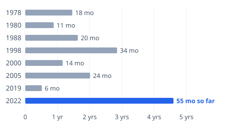
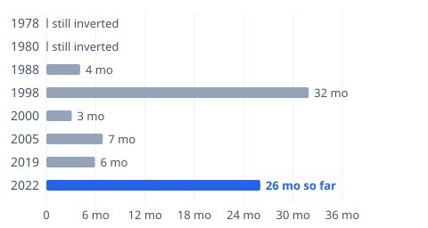

# [When Was the Last Yield Curve Inversion? What History Says](https://mkviz.com/yield-curve-inversion/)

Run from the repository root after `cd engine && cargo build --release && cd ..`.

## yc-lead

Data: [yc-lead.csv](yc-lead.csv) · settings: [yc-lead.json](yc-lead.json)



```
./engine/target/release/mkviz-engine figure lead data/series/fred_T10Y2Y.csv --below --event data/series/fred_USREC.csv --threshold 0 --title 'Months from the first inversion to the next recession' --out yc-lead.svg
```

## yc-after

Data: [yc-after.csv](yc-after.csv) · settings: [yc-after.json](yc-after.json)



```
./engine/target/release/mkviz-engine figure lead data/series/fred_T10Y2Y.csv --below --event data/series/fred_USREC.csv --from-end --threshold 0 --title 'Months from the curve turning positive again to the next recession' --zero-label 'still inverted' --out yc-after.svg
```
